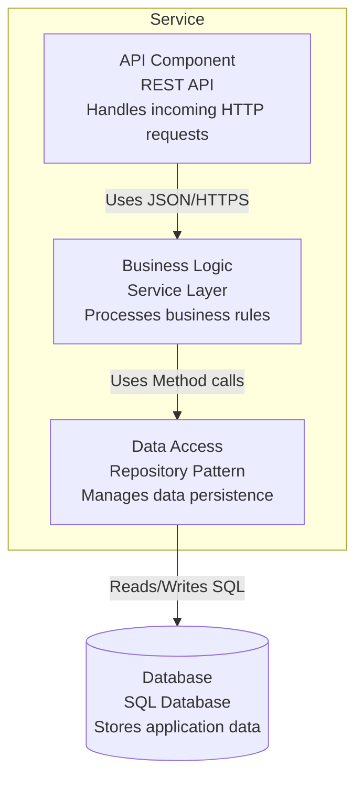
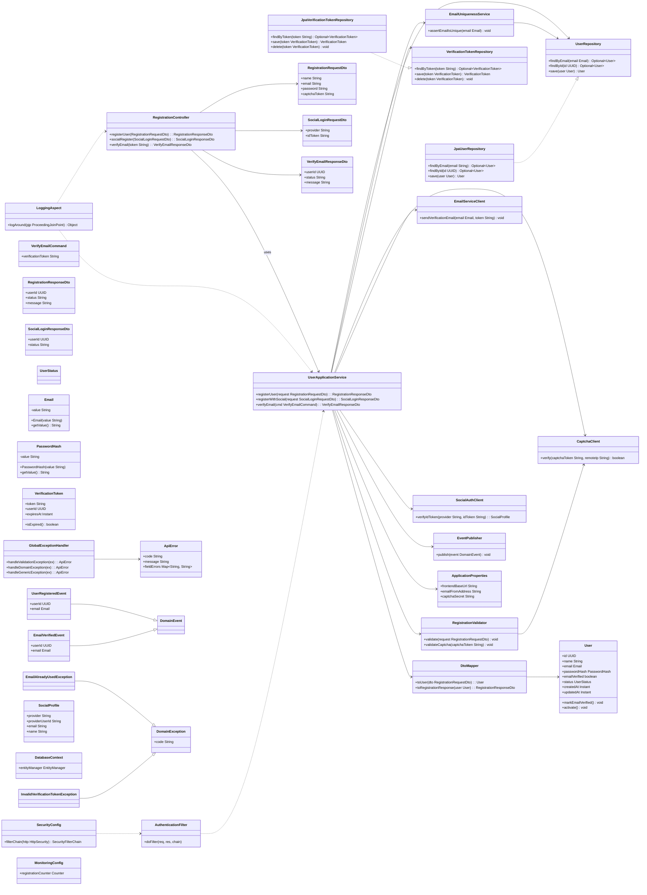

# User Management Service

## C3 — Summary

This C3 component diagram illustrates the internal structure of a service with three main components: API Component for handling requests, Business Logic for processing rules, and Data Access for managing persistence. The components follow a layered architecture pattern with clear separation of concerns.

## C3 — Insights

- The architecture follows a three-tier layered pattern with clear separation between presentation, business, and data layers
- API Component serves as the entry point handling HTTP requests and responses
- Business Logic component encapsulates core business rules and orchestrates operations
- Data Access component abstracts database operations using the Repository pattern
- Dependencies flow in one direction from API to Business Logic to Data Access, promoting maintainability
- The service uses a SQL database for persistent storage

## C3 — Interfaces

### REST API Interface (REST/HTTPS)
HTTP REST interface for external clients to interact with the service

- GET /resources
- POST /resources
- PUT /resources/{id}
- DELETE /resources/{id}


## C3 — Relationships

- ? -> ?
- ? -> ?
- ? -> ?

## C3 — External dependencies

- Database: Stores application data

## C3 — Diagram



## C4 — Classes

- RegistrationController
- GlobalExceptionHandler
- UserApplicationService
- RegistrationValidator
- DtoMapper
- User
- Email
- PasswordHash
- VerificationToken
- UserRepository
- VerificationTokenRepository
- EmailUniquenessService
- UserRegisteredEvent
- EmailVerifiedEvent
- DomainException
- EmailAlreadyUsedException
- InvalidVerificationTokenException
- JpaUserRepository
- JpaVerificationTokenRepository
- EmailServiceClient
- CaptchaClient
- SocialAuthClient
- EventPublisher
- ApplicationProperties

## C4 — Summary

Code-level C4 diagram for S001 User Management Service (User Registration) showing key Spring Boot style controllers, application services, domain entities/value objects, repositories, infrastructure clients, and cross-cutting components for registration, social login, CAPTCHA verification, and email verification flows.

## C4 — Insights

- The RegistrationController is intentionally kept thin, delegating all business rules (email uniqueness, CAPTCHA, social auth, email verification) to UserApplicationService to preserve a clean separation of concerns.
- Domain entities (User, VerificationToken) and value objects (Email, PasswordHash) encapsulate invariants such as valid email format and immutable password hashes, reducing duplication across application services.
- Repository interactions are modeled via interfaces (UserRepository, VerificationTokenRepository) in the domain layer with Jpa* implementations in the infrastructure layer, enabling easier testing and potential technology swaps (e.g., PostgreSQL to MongoDB).
- RegistrationValidator centralizes input validation and CAPTCHA verification, ensuring that malformed input and bot detection are consistently handled in line with acceptance criteria for usability and security.
- EmailUniquenessService wraps UserRepository queries to enforce the email-unique constraint at the domain level, throwing EmailAlreadyUsedException which is mapped to user-friendly API errors by GlobalExceptionHandler.
- VerificationToken is treated as a separate aggregate from User, allowing email verification links to be managed, expired, and deleted independently while still referencing the associated userId.
- Domain events (UserRegisteredEvent, EmailVerifiedEvent) and EventPublisher align the service with an event-driven architecture, allowing downstream services (e.g., Notification Service) to react asynchronously to registration and email verification without tight coupling.
- SocialAuthClient and CaptchaClient are modeled as infrastructure clients, making it straightforward to plug in specific providers (Google, Facebook, reCAPTCHA) and to mock them in tests.
- Cross-cutting concerns (LoggingAspect, SecurityConfig, MonitoringConfig, ApplicationProperties) are separated from the core domain, improving maintainability and making non-functional requirements (security, observability) explicit in the design.
- The diagram emphasizes method signatures and DTOs that directly support the critical user stories and acceptance criteria, rather than exhaustively listing implementation details, keeping the C4 Code view focused and useful.

## C4 — Methods

- **?.RegistrationController.registerUser**
- **?.RegistrationController.socialRegister**
- **?.RegistrationController.verifyEmail**
- **?.UserApplicationService.registerUser**
- **?.UserApplicationService.registerWithSocial**
- **?.UserApplicationService.verifyEmail**
- **?.RegistrationValidator.validate**
- **?.RegistrationValidator.validateCaptcha**
- **?.EmailUniquenessService.assertEmailIsUnique**
- **?.EmailServiceClient.sendVerificationEmail**
- **?.CaptchaClient.verify**
- **?.SocialAuthClient.verifyIdToken**
- **?.User.markEmailVerified**
- **?.User.activate**
- **?.VerificationToken.isExpired**
- **?.EventPublisher.publish**

## C4 — Data structures

- RegistrationRequestDto
- RegistrationResponseDto
- SocialLoginRequestDto
- SocialLoginResponseDto
- VerifyEmailCommand
- VerifyEmailResponseDto
- User
- Email
- PasswordHash
- VerificationToken
- ApiError
- SocialProfile
- ApplicationProperties

## C4 — Code relationships

- Controller delegates all registration and verification operations to the application service, keeping HTTP concerns separate from business logic.
- Application service persists and retrieves User aggregates via repository abstraction.
- Handles creation, lookup, and deletion of VerificationToken records during registration and verification flows.
- Triggers sending of verification emails after successful registration and during potential re-verification scenarios.
- Delegates CAPTCHA verification to an external service as part of registration validation.
- Calls external identity providers to verify social login tokens and obtain user profiles.
- Uses dedicated validator to perform structural and CAPTCHA-related validations on user input.
- Ensures email uniqueness as a business rule before creating new users.
- Publishes UserRegisteredEvent and EmailVerifiedEvent to the messaging infrastructure for downstream processing.
- User is the aggregate root managed by UserRepository for user-related persistent state.
- Repository responsible for persistence operations on VerificationToken entities.
- JPA-backed implementation of the domain UserRepository interface for PostgreSQL storage.
- JPA-backed implementation of VerificationTokenRepository.
- Specialization of DomainException for email uniqueness violations; mapped to HTTP 409 by GlobalExceptionHandler.
- Specialization of DomainException for invalid or expired verification links; leads to informative client messages.
- Concrete domain event emitted when a new user is registered.
- Concrete domain event emitted when a user successfully verifies their email.
- Controller receives RegistrationRequestDto from HTTP body and passes it to UserApplicationService.
- Controller sends RegistrationResponseDto back to clients upon success.
- Maps exceptions to standardized ApiError responses for consistent error handling.
- Instantiates User domain entities from incoming DTOs, enforcing central mapping rules.
- User owns an Email value object that cannot exist independently of a user in this context.
- PasswordHash belongs to User and is used for credential validation by other services such as authentication.

## C4 — Diagram



## API specification — Endpoints

### GET /health
Returns basic health status of the User Management Service, used by load balancers and monitoring systems.

### GET /metrics
Exposes minimal application metrics for monitoring (e.g., uptime, userCount). Only for internal/ops use.

### POST /api/v1/auth/register
Creates a new user account using name, email, and password. Ensures email uniqueness in the PostgreSQL database, validates CAPTCHA, and triggers sending of an email verification OTP/link via SMTP Email Service.

### POST /api/v1/auth/register/social
Handles user onboarding via social media providers such as Google or Facebook. Exchanges a provider-issued token for a local user account and issues a JWT session token. If additional system information is required, it is captured in this call.

### POST /api/v1/auth/login
Authenticates a user using email and password and issues a JWT token for session management. Intended to integrate with User Authentication Service component.

### POST /api/v1/auth/logout
Performs a logical logout for the current JWT session. Depending on implementation, may add the token to a denylist or rely on client-side disposal.

### GET /api/v1/auth/verify-token
Checks whether the provided JWT is valid and not expired. Intended for session verification by clients.

### POST /api/v1/auth/verify-email
Verifies and activates a user account using an email verification OTP code or secure token delivered via email. Handles expired/invalid tokens and responds with appropriate messages.

### GET /api/v1/auth/verification-status
Returns whether a given email address has been verified. Designed for frontend flows that need to adapt UI based on verification state.

### POST /api/v1/auth/refresh
Issues a new JWT access token when provided with a valid refresh token.

### GET /api/v1/users/me
Retrieves the profile of the currently authenticated user, including verification status but excluding sensitive data like password hashes.


## API specification — Summary

User Management Service API focused on user registration, authentication, and email verification. It exposes a minimal, feature-driven set of REST endpoints: email/password registration with CAPTCHA, social login/registration, email verification flows, JWT-based login/logout/verification/refresh, a current-user profile endpoint, and basic health/metrics endpoints. The data models cover registration, authentication tokens, user profiles, email verification, and standardized error formats, aligned with the provided user stories and technical considerations without introducing speculative features.

## API specification — Insights

- Scope endpoints strictly to registration, email verification, social login, and session management; user CRUD beyond /users/me is intentionally omitted because it is not called for by the current feature set.
- The registration endpoint explicitly models CAPTCHA via captchaToken to support bot prevention and clear error handling as required by the CAPTCHA user story.
- Email uniqueness is enforced at the API level with a dedicated 409 conflict response and an EMAIL_ALREADY_EXISTS-style error code in ErrorResponse, mapping directly to the documented exception.
- Email verification supports both short OTP codes and long tokens in a single EmailVerificationRequest model using anyOf to match either flow while keeping the API surface compact.
- Social login is modeled as a single /auth/register/social endpoint that handles both first-time registration (201) and returning-user login (200), matching the acceptance criterion that the flow be equivalent to traditional registration.
- JWT bearer authentication is kept simple: access tokens secure user and session endpoints; an optional refresh token supports longer-lived sessions via /auth/refresh without introducing speculative MFA or complex OAuth flows.
- ValidationErrorResponse with fieldErrors enables the frontend to implement real-time and detailed form feedback across devices, directly supporting the registration form acceptance criteria.
- The /auth/verification-status endpoint provides a controlled way for the UI to adapt based on email verification state and to inform resend-verification UX, while the main auth endpoints avoid leaking unnecessary information.
- Using a separate /auth/verify-token endpoint matches the Authentication Service component’s responsibility to verify sessions and supports lightweight token checks from client apps or gateways.
- Health and metrics endpoints are deliberately minimal and separated by security: /health is public for liveness checks, while /metrics requires an internal API key, aligning with operational needs without overcomplicating observability.

API version: 1.0.0

## API specification — Data models

### HealthStatus

### Metrics

### UserRegistrationRequest

### UserRegistrationResponse

### SocialRegistrationRequest

### LoginRequest

### AuthTokenResponse

### TokenRefreshRequest

### EmailVerificationRequest

### EmailVerificationResponse

### VerificationStatusResponse

### TokenIntrospectionResponse

### UserProfile

### ErrorResponse

### ValidationErrorResponse


## API specification — Error handling

- Use standard HTTP status codes: 200 for successful reads/verification, 201 for successful creations, 204 for successful logout with no content, 400 for malformed input or validation failures, 401 for authentication failures, 409 for email uniqueness conflicts, 410 for expired verification tokens, 422 for semantically invalid verification attempts, and 5xx for server-side errors.
- All error responses should use either ErrorResponse or ValidationErrorResponse models with a consistent JSON structure, enabling clients to rely on 'error' and 'message' fields.
- Validation errors must include field-level detail via ValidationErrorResponse.fieldErrors, supporting real-time feedback on invalid inputs as described in the user stories.
- Use a traceId field on all error responses to correlate client-reported issues with server logs and observability systems.
- Malformed JSON bodies should return HTTP 400 with a ValidationErrorResponse indicating a parsing error (e.g., code: INVALID_JSON).
- Input that is syntactically correct but violates business rules (e.g., duplicate email, invalid or expired verification token) should return appropriate 4xx codes with business-specific error codes in the 'error' field.
- Do not leak sensitive internals (e.g., whether an email is registered) on authentication endpoints; prefer generic messages, but /verification-status is explicitly allowed to reveal existence for UX routines if required by product policy.

## OpenAPI specification

```json
openapi: 3.0.3
info:
  title: User Management Service API
  version: 1.0.0
  description: |
    Handles all user-related operations for registration, authentication, and session
    management. Scope is constrained to user registration (including CAPTCHA and
    social login), email verification, JWT-based authentication, and basic health
    endpoints.
servers:
  - url: https://api.example.com
    description: Production server
  - url: https://staging-api.example.com
    description: Staging server
paths:
  /health:
    get:
      tags: [system]
      summary: Health check
      description: Returns basic health status of the User Management Service.
      responses:
        '200':
          description: Service is healthy
          content:
            application/json:
              schema:
                $ref: '#/components/schemas/HealthStatus'
  /metrics:
    get:
      tags: [system]
      summary: Service metrics
      description: Basic non-PII metrics for monitoring; protected by internal API key.
      security:
        - apiKeyInternal: []
      responses:
        '200':
          description: Metrics payload
          content:
            application/json:
              schema:
                $ref: '#/components/schemas/Metrics'
        '401':
          description: Missing or invalid API key
          content:
            application/json:
              schema:
                $ref: '#/components/schemas/ErrorResponse'
  /api/v1/auth/register:
    post:
      tags: [auth]
      summary: Register a new user
      description: |
        Registers a new user account with name, email, and password. Enforces email
        uniqueness and validates CAPTCHA to prevent bot registrations. On success,
        triggers an email with an OTP or verification link.
      requestBody:
        required: true
        content:
          application/json:
            schema:
              $ref: '#/components/schemas/UserRegistrationRequest'
      responses:
        '201':
          description: User registered; verification email sent.
          content:
            application/json:
              schema:
                $ref: '#/components/schemas/UserRegistrationResponse'
        '400':
          description: Validation or CAPTCHA failure.
          content:
            application/json:
              schema:
                $ref: '#/components/schemas/ValidationErrorResponse'
        '409':
          description: Email already exists.
          content:
            application/json:
              schema:
                $ref: '#/components/schemas/ErrorResponse'
  /api/v1/auth/register/social:
    post:
      tags: [auth]
      summary: Social registration/login
      description: |
        Registers or logs in a user using a social identity provider such as Google
        or Facebook. Exchanges the provider token for a local user and issues a JWT
        session token. If additional information is needed, it is captured via the
        additionalInfo field.
      requestBody:
        required: true
        content:
          application/json:
            schema:
              $ref: '#/components/schemas/SocialRegistrationRequest'
      responses:
        '200':
          description: Existing user logged in via social provider.
          content:
            application/json:
              schema:
                $ref: '#/components/schemas/AuthTokenResponse'
        '201':
          description: New user registered via social provider.
          content:
            application/json:
              schema:
                $ref: '#/components/schemas/AuthTokenResponse'
        '400':
          description: Invalid provider token or missing required additional info.
          content:
            application/json:
              schema:
                $ref: '#/components/schemas/ValidationErrorResponse'
        '401':
          description: Social provider token verification failed.
          content:
            application/json:
              schema:
                $ref: '#/components/schemas/ErrorResponse'
  /api/v1/auth/login:
    post:
      tags: [auth]
      summary: Login with email and password
      description: Authenticates a user and returns a JWT access token and optional refresh token.
      requestBody:
        required: true
        content:
          application/json:
            schema:
              $ref: '#/components/schemas/LoginRequest'
      responses:
        '200':
          description: Authenticated successfully.
          content:
            application/json:
              schema:
                $ref: '#/components/schemas/AuthTokenResponse'
        '400':
          description: Malformed request or validation error.
          content:
            application/json:
              schema:
                $ref: '#/components/schemas/ValidationErrorResponse'
        '401':
          description: Invalid credentials.
          content:
            application/json:
              schema:
                $ref: '#/components/schemas/ErrorResponse'
  /api/v1/auth/logout:
    post:
      tags: [auth]
      summary: Logout current session
      description: Logs out the current user session represented by the bearer token.
      security:
        - bearerAuth: []
      responses:
        '204':
          description: Logout successful.
        '401':
          description: Missing or invalid token.
          content:
            application/json:
              schema:
                $ref: '#/components/schemas/ErrorResponse'
  /api/v1/auth/verify-token:
    get:
      tags: [auth]
      summary: Verify JWT token
      description: Checks whether a provided JWT access token is active and not expired.
      security:
        - bearerAuth: []
      responses:
        '200':
          description: Token is valid.
          content:
            application/json:
              schema:
                $ref: '#/components/schemas/TokenIntrospectionResponse'
        '401':
          description: Token invalid or expired.
          content:
            application/json:
              schema:
                $ref: '#/components/schemas/ErrorResponse'
  /api/v1/auth/verify-email:
    post:
      tags: [auth]
      summary: Verify email
      description: Verifies a user's email using an OTP code or verification token.
      requestBody:
        required: true
        content:
          application/json:
            schema:
              $ref: '#/components/schemas/EmailVerificationRequest'
      responses:
        '200':
          description: Email verified and account activated.
          content:
            application/json:
              schema:
                $ref: '#/components/schemas/EmailVerificationResponse'
        '400':
          description: Malformed request or validation error.
          content:
            application/json:
              schema:
                $ref: '#/components/schemas/ValidationErrorResponse'
        '410':
          description: Verification token or OTP expired.
          content:
            application/json:
              schema:
                $ref: '#/components/schemas/ErrorResponse'
        '422':
          description: Verification token or OTP invalid.
          content:
            application/json:
              schema:
                $ref: '#/components/schemas/ErrorResponse'
  /api/v1/auth/verification-status:
    get:
      tags: [auth]
      summary: Get email verification status
      description: Returns whether a given email has been verified.
      parameters:
        - in: query
          name: email
          required: true
          schema:
            type: string
            format: email
          description: Email address to check.
      responses:
        '200':
          description: Verification status for the provided email.
          content:
            application/json:
              schema:
                $ref: '#/components/schemas/VerificationStatusResponse'


_(truncated -- content exceeds the reference file size budget)_
```
